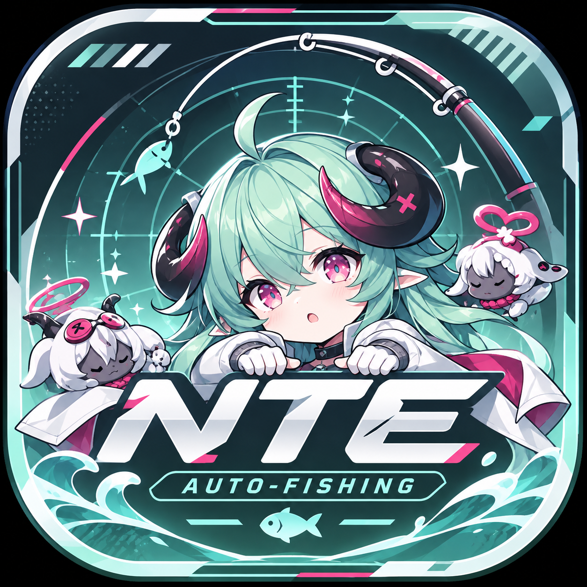
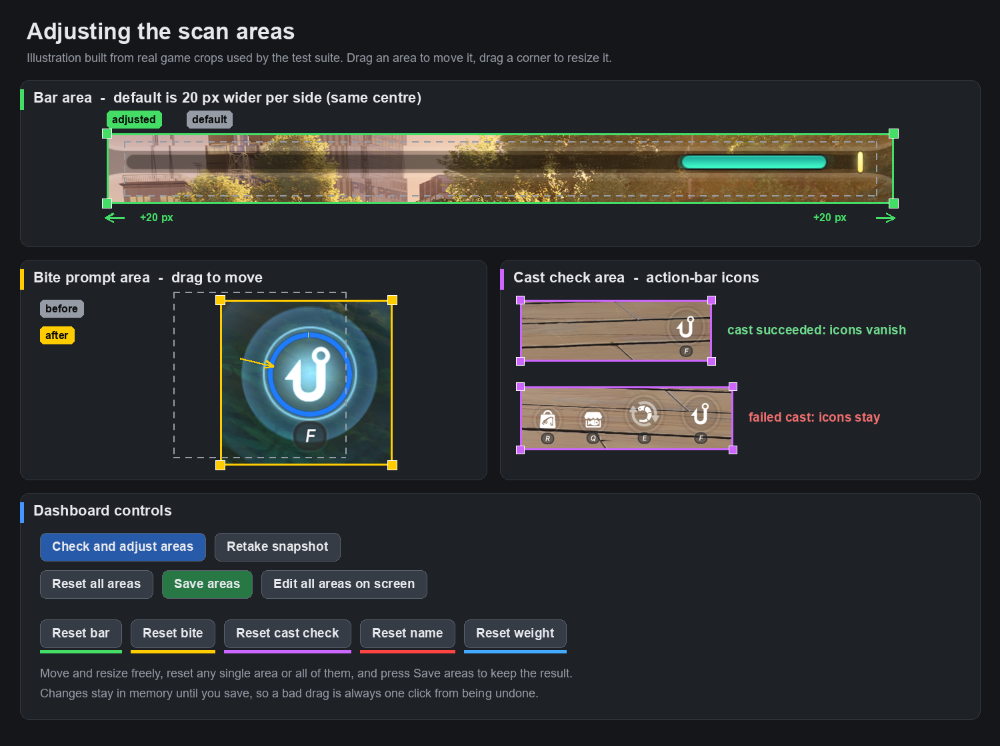

<div align="center">



# NTE Auto-Fishing

[English](README.md) | [简体中文](docs/README_zh.md) | [日本語](docs/README_ja.md)

**A visual, configurable auto-fishing assistant built for responsive game control.**

Built with Python, OpenCV, MSS, PyDirectInput, and DearPyGui.

---

[](https://github.com/vnoiram/NTE-auto-fish/blob/main/LICENSE)
[](https://github.com/vnoiram/NTE-auto-fish/releases)
[](https://github.com/vnoiram/NTE-auto-fish/releases)
[](https://github.com/vnoiram/NTE-auto-fish/actions)
[](https://github.com/vnoiram/NTE-auto-fish/stargazers)

</div>

## About This Fork

This repository is a fork of [Chizukuo/NTE-auto-fish](https://github.com/Chizukuo/NTE-auto-fish). The additions below were written by the fork's author and are what make this fork the better choice for day-to-day use:

- **Game monitor auto-select (experimental)**: On launch the monitor that shows the game window is picked automatically (can be turned off in Settings), and the bot recalibrates if you change the monitor while paused.
- **Auto stop from the dashboard**: Set a fish count and/or a time (minutes and seconds) and press Set. Counting starts from that moment, `0` means no limit, and a timed stop waits for the fish in progress and ends before the next cast.
- **Start delay**: A random 1.4-2.6 s pause between pressing Start and the first cast, so the game window can take focus.
- **Much better area editing**: A progress log for the area check, retake next to the check button, a one-click on-screen editor, per-area and all-areas reset, an explicit Save, and drag or width/height adjustment for the bite and cast check areas too.
- **Sturdier tracking**: The cursor is still tracked when it reaches the very edge of the bar, and the default bar area is slightly wider.
- **More human-like input**: Upstream already had a basic humanization layer (key pulses, reaction latency, small corrections). This fork extends it with varied cursor movement styles (slow moves, flicks, occasional random actions) and a unified timing variation applied across the bot, and retunes the defaults.
- **Better bait-exhausted / failed-cast detection**: Instead of reading dialog text or relying on waiting times, it checks whether the action-bar icons are still visible after a cast. It does not depend on the game language or on timing, so it is stable.
- **Day / evening / night profiles (experimental)**: Detection colour profiles for each time of day, plus automatic recognition of the background to switch profiles and raise the detection rate.
- **Faster area-check OCR.**
- **One executable for GUI and CLI**: There is no separate CLI package; the same EXE opens the GUI, or runs the CLI when started with arguments.
- **More ways to build**: Build locally in Windows Sandbox, or prepare on Linux and let the Windows GitHub Actions runner build the EXE and download it (see the build sections below).
- **Stable builds**: The default icon is the character artwork and builds get a plain, fixed name (no random build ID unless you ask for one).



**Why there is no pull request upstream:** there are "religious" differences (in the engineer sense: matters of taste, not of correctness) between upstream and this fork: a random name instead of a fixed one, a different character as the icon, and Python 3.14 instead of 3.11. This fork implements them, I prefer them, and I do not want to push them onto upstream.  
※ The random-name feature is experimental and is not included in the builds.

**The bigger reason:** upstream has not merged any outside pull request since 2026-06. As of 2026-11-10, two open pull requests ([#60](https://github.com/Chizukuo/NTE-auto-fish/pull/60), [#61](https://github.com/Chizukuo/NTE-auto-fish/pull/61)) are marked as mergeable without conflicts and have been left for months. A new one would most likely not be merged either, so I consider it wasted effort.

**Support policy:** this fork is disposable. There will be no regular updates and no effort to follow upstream changes.

## Highlights

- **Live control center**: Track bot state, fish count, session time, FPS, PID output, ROI data, and vision health in one GUI.
- **Safer controls**: The GUI starts paused, handles stop commands urgently, and releases held keys during pause, stop, recalibration, and shutdown.
- **Runtime tuning**: PID, HSV thresholds, timing, input keys, hotkeys, calibration, and debug options can be adjusted from the Settings tab. ([Settings Guide](docs/SETTINGS_GUIDE.md))
- **Resolution adaptation**: Ratio-based ROI calibration with resolution-proportional fallback supports 1080p, 2K, 4K, and custom display sizes automatically.
- **Fast capture and input**: `mss` captures screen regions efficiently, while `PyDirectInput` sends game-friendly input events.
- **Portable builds**: GitHub Actions produces a single-file Windows EXE for GUI and a lightweight source package for CLI.

## Project Structure

| Path | Description |
| :--- | :--- |
| `start_gui.py` | Recommended GUI entry point (also runs the CLI when given arguments). |
| `main.py` | Headless entry point and core bot loop. |
| `config.py` | Runtime configuration for PID, HSV, keys, timing, and calibration. |
| `gui/` | DearPyGui control center, panels, and thread-safe bridge. |
| `modules/` | Capture, input, vision, and fishing logic modules. |
| `templates/` | Ratio data for automatic ROI calibration. |
| `tools/ratio_annotator.py` | Utility for creating ratio-based ROI JSON from screenshots. |

## Getting Started

### Option 1: Prebuilt Executable (GUI and CLI in one file)

1. Download the latest `NTE-Auto-Fish-v*.*.*-Windows-x64.exe` from [Releases](https://github.com/vnoiram/NTE-auto-fish/releases).
2. Run it as Administrator so simulated input can reach the game.
3. The same EXE also runs the CLI when started with arguments from a terminal, e.g. `NTE-Auto-Fish.exe start` or `NTE-Auto-Fish.exe --help`
   (commands: `start`, `calibrate`, `config show/set`, `reset`). With no arguments it opens the GUI. Because the EXE requests
   administrator rights, run it from an elevated terminal to see output in the same window; otherwise a new console window opens.

### Option 2: Run From Source

```bash
git clone https://github.com/vnoiram/NTE-auto-fish.git
cd NTE-auto-fish
pip install -r requirements.txt
```

Launch the GUI:

```bash
python start_gui.py
```

Launch headless mode:

```bash
python main.py
```

### Build a Windows EXE from Linux

PyInstaller is not a cross-compiler, and this application uses Windows-only input APIs. The Linux helper therefore
starts the repository's Windows GitHub Actions runner and downloads its artifact. Install and authenticate the
[GitHub CLI](https://cli.github.com/) first, and push the branch and icon file before building.

```bash
./scripts/build-from-linux.sh \
  --app-name "Fishing Tools" \
  --icon classic
```

The artifact is downloaded to `dist/remote/`. Branding is configurable: `--app-name` changes the EXE,
window, and sidebar name, while `--icon` changes the EXE and window icon. Built-in choices are `classic`, `bobber`,
`target-fish`, and `fisher-cat`; the default is `classic` (the character artwork) and `random` picks one per build.
Provide a custom `.ico` path to use your own.
On Windows, run the same build directly with `python scripts/build_windows.py --app-name "Fishing Tools" --icon classic`. App names are ASCII-only
to avoid native Windows title-bar encoding problems. By default no build ID is added, so the file name, window title
and settings file stay the same between builds. Pass `--build-id my-id` to add an ID, or `--build-id random` to
generate a unique one to prevent artifact collisions.
Branded builds also namespace their settings, log, debug CSV, and session directory with the app name and build ID,
so multiple builds can run from the same directory without overwriting each other's runtime data. Unbranded source
runs retain the legacy filenames.

### Build locally in Windows Sandbox

For a fully local build without GitHub Actions, enable Windows Sandbox and run this from Windows PowerShell:

```powershell
# Run once as Administrator, then restart Windows if prompted.
Enable-WindowsOptionalFeature -Online -FeatureName "Containers-DisposableClientVM" -All

# Run from the repository on subsequent builds.
powershell.exe -NoProfile -ExecutionPolicy Bypass -File .\scripts\build_with_windows_sandbox.ps1 -AppName "Fishing Tools" -Icon classic
```

From WSL, the equivalent local command is:

```bash
./scripts/build-with-windows-sandbox.sh -AppName "Fishing Tools" -Icon classic
```

If Windows Sandbox crashes while executing its automatic logon command, start it in manual mode:

```bash
./scripts/build-with-windows-sandbox.sh -Manual -AppName "Fishing Tools" -Icon classic
```

Manual mode neither starts Windows Sandbox nor waits for it. The script generates the `.wsb` file, prints its path and the
command to run, copies that command to the host clipboard, and exits. Open the `.wsb` file yourself and paste the command into
PowerShell inside the Sandbox. The output directory (`dist\sandbox` by default) is mapped into the Sandbox, so the EXE and
`sandbox-build.log` appear there directly. The staged source is kept in the printed temporary directory; delete it afterwards.
Clipboard redirection is enabled only for this mode so the command can be pasted.

The script stages a temporary read-only copy of the source, starts Windows Sandbox, installs Python and the build
dependencies inside it, and copies only the resulting EXE to `dist\sandbox`. Python installers and pip downloads are
cached under the current user's local application data to make later builds faster. The temporary Sandbox and staged
source are discarded after each build. A custom output directory, stable build ID, or named built-in icon can be set
with `-OutputDirectory`, `-BuildId`, and `-Icon`. Build details and failures are retained in `sandbox-build.log`.

## Notes

- Run from an elevated terminal on Windows.
- Borderless window or windowed fullscreen usually gives the most reliable capture behavior.
- Hotkeys are configurable in the GUI and re-register after editing.
- Debug logging writes extra tracking data to `fishing_data.csv`; branded builds add their build namespace to the filename.

## Known Issues

- **Dawn/dusk lighting**: During in-game sunrise and sunset, the warm yellow ambient lighting significantly interferes with HSV-based cursor detection, causing tracking failures and drastically reduced fishing success rates. This is an inherent limitation of the current color-based detection approach. If you encounter this, consider adjusting the cursor HSV thresholds in Settings to compensate for the shifted lighting conditions.

---

<div align="center">
Built for practical, low-friction automation.
</div>
