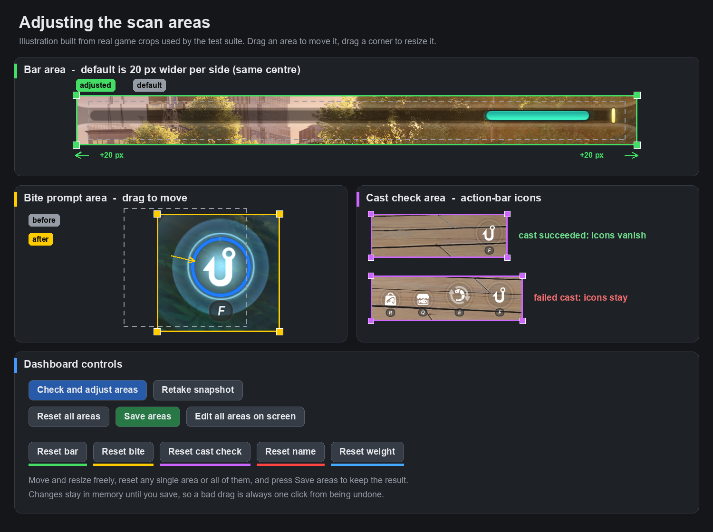

<div align="center">

# NTE Auto-Fishing

[English](../README.md) | [简体中文](README_zh.md) | [日本語](README_ja.md)

**リアルタイムなゲーム操作に向けた、可視化と調整ができる自動釣りアシスタントです。**

Python、OpenCV、MSS、PyDirectInput、DearPyGui で構築されています。

---

[](https://github.com/vnoiram/NTE-auto-fish/blob/main/LICENSE)
[](https://github.com/vnoiram/NTE-auto-fish/releases)
[](https://github.com/vnoiram/NTE-auto-fish/actions)
[](https://github.com/vnoiram/NTE-auto-fish/stargazers)

</div>

## このフォークについて

このリポジトリは [Chizukuo/NTE-auto-fish](https://github.com/Chizukuo/NTE-auto-fish) のフォークです。以下の追加機能はフォーク作者が実装したもので、普段使いではこのフォークのほうが優れています。

- **ゲームのモニターを自動選択(実験的)**：起動時にゲームのウィンドウがあるモニターを自動で選びます(設定でオフにできます)。一時停止中にモニターを変えた場合は、開始時に測り直します。
- **ダッシュボードから自動停止**：釣果数や時間(分・秒)を指定して「設定」を押すと、その時点から数えて自動で停止します。`0` は無制限です。時間指定のときは、釣っている最中の魚を釣り終えてから、次のキャストの前に止まります。
- **開始後の待ち**：「開始」を押してから最初のキャストまでに、1.4〜2.6 秒のランダムな待ちを入れます。ゲームのウィンドウに切り替える時間を確保できます。
- **領域の調整が大幅に改善**：領域確認の進捗ログ、確認ボタンの右に撮り直し、画面上でドラッグして編集するボタン、領域ごと・全体のリセット、明示的な保存、アタリ領域とキャスト判定領域のドラッグ・幅高さ調整に対応しました。
- **追跡の強化**：カーソルがバーの一番端に行っても追跡を続けます。既定のバー領域も少し広げました。
- **より人間らしい動作**：本家にも基本的な人間らしい動作(キーのパルス、反応の遅れ、小さな修正操作)はすでにありました。このフォークでは、カーソルの動きに複数のスタイル(ゆっくりした動き、素早い切り返し、ときどきの余計な操作)を加え、全体に効くタイミングのばらつきを統一して追加し、既定値も調整しています。
- **エサ不足・キャスト失敗の検知を改善**：ダイアログの文字や待ち時間に頼らず、キャスト後にアクションバーのアイコンが残っているかで判定します。ゲームの言語にも時間的なタイミングにも依存しないので、安定して検知できます。
- **昼・夕・夜のプロファイル(実験的)**：時間帯ごとの検知色のプロファイルを用意し、背景を自動で認識してプロファイルを切り替えることで、検知率を高める機能を追加しました。
- **領域確認の OCR を高速化**しました。
- **GUI と CLI を 1 つの実行ファイルに統合**：CLI 専用のパッケージはありません。同じ EXE が GUI として開き、引数付きで起動すると CLI として動きます。
- **ビルド方法の追加**：Windows Sandbox でのローカルビルドと、Linux で準備して Windows の GitHub Actions ランナーでビルドし、EXE をダウンロードする方法を追加しました(下のビルドの節を参照)。
- **固定のビルド**：既定のアイコンはキャラクターのイラストで、ビルドの名前は固定です(指定しない限りランダムなビルド ID は付きません)。



**本家へプルリクエストを出さない理由**：本家とこのフォークには宗教的な違い(エンジニアの言う「宗教」、つまり正しさではなく好みの問題)があります。固定名ではなくランダム名にすること、アイコンを別のキャラクターにすること、Python を 3.11 ではなく 3.14 にすることです。このフォークではそれらを実装しており、私はそれらを好んでいるため、本家側に追加してもらうつもりはありません。  
※ ランダム名にする機能は実験的なものなので、ビルドには含めていません。

**そして、これが大きな理由です**：本家では、2026-06 以降、外部のプルリクエストがマージされていません。2026-11-10 時点で、競合なしでマージ可能な PR が 2 件([#60](https://github.com/Chizukuo/NTE-auto-fish/pull/60)、[#61](https://github.com/Chizukuo/NTE-auto-fish/pull/61))、数か月放置されています。出しても取り込まれない可能性が高く、労力の無駄だと考えています。

**サポート方針**：このフォークは使い捨てです。定期的なアップデートや、本家への追随は行いません。

## 特長

- **ライブ操作パネル**：状態、釣果数、セッション時間、FPS、PID 出力、ROI、視覚トラッキングの状態を GUI で確認できます。
- **安全な制御フロー**：GUI 起動時は一時停止状態で開始し、停止コマンドを優先処理し、一時停止・停止・再校正・終了時に押下中のキーを解放します。
- **実行中の調整**：PID、HSV しきい値、タイミング、入力キー、グローバルホットキー、校正、デバッグ設定を Settings タブから調整できます。([設定ガイド](SETTINGS_GUIDE_ja.md))
- **解像度への適応**：比率ベースの ROI 校正と解像度比例フォールバックにより、1080p、2K、4K およびカスタム解像度に自動対応します。
- **高速なキャプチャと入力**：`mss` で画面領域を取得し、`PyDirectInput` でゲーム向けの入力イベントを送信します。
- **ポータブルビルド**：GitHub Actions が GUI 用の単一ファイル EXE と CLI ソースパッケージを生成します。

## プロジェクト構成

| パス | 説明 |
| :--- | :--- |
| `start_gui.py` | 推奨される GUI 起動エントリーポイント。 |
| `main.py` | ヘッドレス実行とコア Bot ループ。 |
| `config.py` | PID、HSV、キー、タイミング、校正の実行時設定。 |
| `gui/` | DearPyGui の操作画面、パネル、スレッド安全なブリッジ。 |
| `modules/` | キャプチャ、入力、画像認識、釣りロジックのモジュール。 |
| `templates/` | 自動 ROI 校正用の比率データ。 |
| `tools/ratio_annotator.py` | スクリーンショットから比率ベースの ROI JSON を作成する補助ツール。 |

## はじめ方

### 方法 1：ビルド済み実行ファイル（GUI と CLI を 1 つに統合）

1. [Releases](https://github.com/vnoiram/NTE-auto-fish/releases) から最新の `NTE-Auto-Fish-v*.*.*-Windows-x64.exe` をダウンロードします。
2. ゲームへ入力を届けるため、管理者権限で実行します。
3. 同じ EXE を、ターミナルから引数付きで起動すると CLI として動きます。例：`NTE-Auto-Fish.exe start`、`NTE-Auto-Fish.exe --help`
   (コマンド：`start`、`calibrate`、`config show/set`、`reset`)。引数なしで起動すると GUI が開きます。EXE は管理者権限を要求するため、
   同じウィンドウに出力を表示するには、管理者権限のターミナルから実行してください。そうでない場合は、新しいコンソールウィンドウが開きます。

### 方法 2：ソースから実行

```bash
git clone https://github.com/vnoiram/NTE-auto-fish.git
cd NTE-auto-fish
pip install -r requirements.txt
```

GUI を起動：

```bash
python start_gui.py
```

ヘッドレスモードを起動：

```bash
python main.py
```

### Linux から Windows EXE をビルド

PyInstaller はクロスコンパイラではなく、このアプリも Windows 専用入力 API を使用します。そのため、
Linux 用スクリプトは GitHub Actions の Windows runner を起動し、生成物をダウンロードします。
事前に [GitHub CLI](https://cli.github.com/) をインストールして認証し、対象ブランチとアイコンを push してください。

```bash
./scripts/build-from-linux.sh \
  --app-name "Fishing Tools" \
  --icon classic
```

成果物は `dist/remote/` に保存されます。`--app-name` は EXE・ウィンドウ・サイドバー名へ、`--icon` は
EXE とウィンドウアイコンへ反映されます。組み込みアイコンは `classic`、`bobber`、`target-fish`、
`fisher-cat` の4種類で、既定は `classic`(キャラクターのアイコン)で、`random` を指定するとビルドごとに1種類を選びます。独自の `.ico` パスも指定できます。
Windows 上で直接ビルドする場合は
`python scripts/build_windows.py --app-name "Fishing Tools" --icon classic` を実行します。Windowsの
タイトルバー文字化けを避けるため、アプリ名はASCII文字のみ指定できます。
既定ではビルドIDを付けないため、EXE名・ウィンドウタイトル・設定ファイル名はビルド間で変わりません。
IDを付けたい場合は `--build-id my-id`、ビルドごとの一意なIDが必要な場合は `--build-id random` を指定します。
ブランド付きビルドでは設定・ログ・デバッグCSV・セッション保存先にもアプリ名とビルドIDを付けるため、
同じフォルダに複数のビルドを置いても実行時データが上書きされません。ソースからの通常実行は従来名を維持します。

### Windows Sandboxでローカルビルド

GitHub Actionsを使わず手元だけでビルドする場合は、Windows Sandboxを有効にしてWindows PowerShellから実行します。

```powershell
# 初回のみ管理者PowerShellで実行し、求められた場合はWindowsを再起動します。
Enable-WindowsOptionalFeature -Online -FeatureName "Containers-DisposableClientVM" -All

# 以降はリポジトリから実行します。
powershell.exe -NoProfile -ExecutionPolicy Bypass -File .\scripts\build_with_windows_sandbox.ps1 -AppName "Fishing Tools" -Icon classic
```

WSLから起動する場合も、GitHubを経由せず次のコマンドで同じローカルビルドを実行できます。

```bash
./scripts/build-with-windows-sandbox.sh -AppName "Fishing Tools" -Icon classic
```

Sandboxの自動ログオンコマンド実行時に落ちる環境では、手動モードで起動します。

```bash
./scripts/build-with-windows-sandbox.sh -Manual -AppName "Fishing Tools" -Icon classic
```

手動モードではWindows Sandboxを起動せず、完了も待ちません。`.wsb`ファイルを生成してそのパスと実行コマンドを表示し、
コマンドをホストのクリップボードへコピーして終了します。`.wsb`を自分で開き、Sandbox内のPowerShellにコマンドを貼り付けて実行してください。
出力先フォルダ（既定は`dist\sandbox`）がSandboxへ直接マウントされるため、EXEと`sandbox-build.log`はそこへ直接出力されます。
ソースの一時コピーは表示されたフォルダに残るので、ビルド後に削除してください。コマンドを貼り付けられるよう、このモードに限りクリップボード共有を有効にします。

ソースの一時コピーはSandboxへ読み取り専用で共有され、Python・依存関係・PyInstallerはSandbox内へ導入されます。
完成したEXEだけが `dist\sandbox` に戻り、Sandboxと一時コピーはビルド後に破棄されます。2回目以降を速くするため、
Pythonインストーラーとpipのダウンロードだけはユーザーのローカルアプリデータへキャッシュします。
`-OutputDirectory`、`-BuildId`、`-Icon` で出力先、固定ID、アイコンを指定できます。ビルド詳細や失敗内容は
`sandbox-build.log` に残ります。

## 注意

- Windows では管理者権限のターミナルから実行することを推奨します。
- ボーダーレスウィンドウまたはウィンドウ化フルスクリーンのほうが、キャプチャが安定しやすくなります。
- グローバルホットキーは GUI で変更でき、編集後に再登録されます。
- デバッグログは追加のトラッキングデータを `fishing_data.csv` に書き込みます。ブランド付きビルドではファイル名にビルド識別子が付きます。

## 既知の問題

- **夕暮れ・日の出時の照明干渉**：ゲーム内の日の出・日没時の暖色系の環境光が HSV ベースのカーソル検出に深刻な干渉を与え、追跡失敗や釣り成功率の大幅な低下を引き起こします。これは現在の色ベース検出方式の inherent な限界です。这种情况に遭遇した場合、設定でカーソルの HSV 閾値を調整して照明条件の変化に対応してください。
